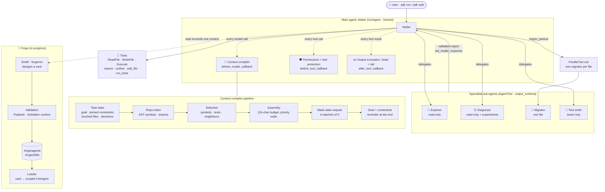

<div align="center">

# ⚒️ Forge Code

**A terminal coding agent that compiles its own context and delegates to specialist sub-agents when a task outgrows one context window.**

[](https://www.python.org/)
[](https://google.github.io/adk-docs/)
[](https://cloud.google.com/vertex-ai/generative-ai/docs/models)
[](https://cloud.google.com/vertex-ai)
[](https://phoenix.arize.com/)
[](tests/)

</div>

---

## In 30 seconds

Coding agents tend to fail on long tasks for the same reasons. The prompt fills up with stale tool outputs, the
user's constraints get lost in the middle of the history, and a single agent tries to do everything at once.

**Forge Code** tackles this with three ideas, each measured on a reproducible benchmark:

1. **A context compiler** rebuilds the request before every model call. It pins the task state and the
   user's constraints, orders the prompt against *lost in the middle*, and masks stale tool outputs **in
   batches** so the prompt prefix stays stable and cache-friendly.
2. **Specialist sub-agents** (explorer, diagnoser, migrator, test writer) each get a narrow toolset, a hard
   write scope and a **schema-validated report**. The main agent receives a short, checked answer
   instead of a pile of raw output.
3. **A forge** *(in progress)* lets the main agent design a *new* sub-agent (a YAML card plus skills). The
   card is validated, given a write scope and loaded as an ADK `LlmAgent`.

A **12-task benchmark on [Jinja](https://github.com/pallets/jinja)** (6 task families, hidden tests,
regression checks on the full test suite, a mutation-based judge for test writing) compares three agent
configurations, with OpenTelemetry tracing in [Phoenix](https://phoenix.arize.com/).

> [!NOTE]
> The code, prompts and agent names are in **French**, and the agent answers in French. See the
> [glossary](#glossary) for the English names used in this README.

---

## Key features

| | Feature | Where |
|---|---|---|
| 🧠 | **Context compiler**: structured task state, AST repo index, file and symbol selection, fixed-budget assembly, batch masking of old tool outputs, goal and constraints reminder at the end | [`app/context/`](app/context/) |
| 🧭 | **Explorer**: read-only code localisation and explanation | [`app/sub_agents/explorateur/`](app/sub_agents/explorateur/) |
| 🩺 | **Diagnoser**: groups failing tests by error, reproduces one on a minimal case and proposes the fix without editing anything | [`app/sub_agents/diagnostiqueur/`](app/sub_agents/diagnostiqueur/) |
| 🔁 | **Migrator** + `migrer_partout`: repo-wide rename or API migration, one migrator per file run in parallel, then a final search for leftovers | [`app/orchestration/migrer_partout.py`](app/orchestration/migrer_partout.py) |
| 🧪 | **Test writer**: writes pytest tests only under `tests/` and reports the bugs they uncover | [`app/sub_agents/redacteur_tests/`](app/sub_agents/redacteur_tests/) |
| 🔨 | **Forge**: the smith (`forgeron`) designs a sub-agent card. Cards are validated with Pydantic (tools and skills by name only, no arbitrary code) and loaded with a write scope | [`app/agents_forges/`](app/agents_forges/) |
| 🛡️ | **Permissions**: `ask` / `auto-edit` / `auto` modes, a command allow-list, always-denied commands (`git push`, `.env`, `rm -rf /`…), existing tests protected unless the user asked for tests | [`app/permissions.py`](app/permissions.py) |
| 🔌 | **ADK plugins**: reflect-and-retry on tool errors, redirection of hallucinated tools, targeted hints (e.g. "call the diagnoser"), an import check right after each edit | [`app/plugins/`](app/plugins/) |
| 📚 | **Skills** loaded on demand (`migration`, `ecriture-tests`): only their name and description sit in the prompt | [`app/skills/`](app/skills/) |
| 📊 | **Benchmark**: A/B/C configurations, hidden tests, regression check, mutation judge, token and call counts per agent | [`bench/`](bench/) |
| 🔭 | **Tracing**: every model and tool call, in the main agent and the sub-agents, exported over OTLP to Phoenix | [`app/traces.py`](app/traces.py) |

---

## Architecture



### How the context compiler works

The compiler is a `before_model_callback` ([`app/context/compiler.py`](app/context/compiler.py)). It only
edits the **outgoing request**; the session history stays intact. It is enabled with `FORGE_CONTEXT=on`.

| Position in the prompt | Content | Why |
|---|---|---|
| **Head** (system instruction) | Task state (goal, pinned constraints, files modified, decisions noted with `noter_decision`), `AGENTS.md` if present, full code of the targeted symbols, related tests, signatures of the main file and its import neighbours, all under a 12,000-character budget | The model reads the beginning best, so a constraint given at step 1 is still visible at step 40 |
| **Middle** | The history, with useless tool outputs replaced by a one-line stub | Old outputs cost tokens and distract the model |
| **Tail** | A `<rappel_systeme>` note with the goal and **all** pinned constraints | The end of the prompt is also read well |

Masking rules:

- **Immediately:** a `ReadFile` or `outline` of a file that was edited later (its content is stale), and any
  `run_tests` output superseded by a newer one.
- **In batches:** outputs older than the 10 most recent are masked **5 at a time**. Moving the boundary in jumps,
  instead of by one output per call, keeps the prompt prefix identical between calls so it can be served
  from the model's cache.
- **Emergency:** above about 400,000 characters, only the last 3 outputs are kept whole.
- **Never masked:** loaded skills (`load_skill`).

### How specialists report back

Each specialist has a Pydantic `output_schema`. Forge Code forces the final answer through ADK's
`set_model_response` tool, Vertex AI included, so the schema validators always run (paths that exist,
numbered lines, the smith's rules). A malformed report goes back to the model to be fixed
([`app/sub_agents/rapport.py`](app/sub_agents/rapport.py)).

---

## Quickstart

### Prerequisites

- Python **3.11+** and [`uv`](https://docs.astral.sh/uv/)
- A Google Cloud project with **Vertex AI** enabled, and the [`gcloud` CLI](https://cloud.google.com/sdk/docs/install)
- Optional: [`ripgrep`](https://github.com/BurntSushi/ripgrep) for a faster `search` (there is a pure-Python fallback)

### 1. Install

```bash
git clone https://github.com/kingWD123/Forge.git
cd Forge
uv sync                    # runtime + dev dependencies (ADK, pytest)
uv sync --extra traces     # optional: Phoenix / OpenTelemetry tracing
```

### 2. Configure

```bash
gcloud auth application-default login
cp .env.example .env
```

Then edit `.env`:

| Variable | Default | Purpose |
|---|---|---|
| `GOOGLE_GENAI_USE_VERTEXAI` | `1` | Use Gemini through Vertex AI |
| `GOOGLE_CLOUD_PROJECT` | *ADC project* | GCP project, taken from your `gcloud` credentials if unset |
| `GOOGLE_CLOUD_LOCATION` | `us-central1` | Vertex AI region |
| `MODEL_NAME` | `gemini-2.5-flash` | Model for the main agent and the specialists |
| `EXPLORATEUR_MODEL` | `MODEL_NAME` | Optional cheaper or faster model for the explorer |
| `FORGE_WORKSPACE` | current directory | Repository the agent works on; every path is confined to it |
| `FORGE_PERMISSION_MODE` | `ask` | `ask` · `auto-edit` (free writes) · `auto` (everything except denied commands) |
| `FORGE_CONTEXT` | `off` | `on` enables the context compiler |
| `FORGE_SPECIALISTES` | `on` | `off` removes the specialists (plain coding agent) |
| `FORGE_TRACES` | `off` | `on` exports traces to Phoenix |
| `FORGE_TRACES_PROJET` | `forge-code` | Phoenix project name |
| `PHOENIX_COLLECTOR_ENDPOINT` | `http://localhost:6006` | Phoenix collector URL |
| `FORGE_TEST_PYTHON` | — | Python used by `run_tests` when the target repo has no `.venv` |

### 3. Run

```bash
# Terminal chat
uv run adk run app

# Or the ADK web UI, which shows tool calls and confirmation prompts (pick the "app" agent)
uv run adk web
```

Point it at another repository with `FORGE_WORKSPACE=/path/to/repo`. For the full setup measured in the
benchmark (configuration C), also set `FORGE_CONTEXT=on`.

For traces, start a local Phoenix server (`uv run phoenix serve`), set `FORGE_TRACES=on` and open
http://localhost:6006.

---

## Usage example

```text
$ FORGE_WORKSPACE=~/code/jinja FORGE_CONTEXT=on uv run adk run app

[user]: Beaucoup de tests échouent depuis le dernier changement. Trouve la cause et corrige-la.
        (Many tests fail since the last change. Find the cause and fix it.)
```

What the agent is built to do on this kind of task:

1. `run_tests` reports dozens of failures, and the **hints** plugin tells the Atelier to call the diagnoser
   before editing anything.
2. The **diagnoser** groups the failures by error type (`regrouper_echecs`), reproduces one in a read-only
   script (`experimenter`) and returns a validated report: cause, file, lines and proposed fix.
3. The Atelier applies the fix with `edit_file`. In `ask` mode you see the diff and approve it. Right after
   the edit, the **import check** plugin verifies that the module still imports.
4. It runs `run_tests` again. The compiler masks the older test output, so only the latest one stays in context.

Other prompts to try:

```text
Renomme le décorateur internalcode en mark_internal partout.   → migrer_partout (parallel migrators)
Écris des tests pour src/jinja2/meta.py.                       → test writer + `ecriture-tests` skill
Où est implémenté le filtre truncate et qui l'utilise ?        → explorer
```

---

## Benchmark

The benchmark answers one question: **does each layer actually help, and at what token cost?**

### Configurations

| Config | Context compiler | Specialists | Description |
|---|:---:|:---:|---|
| **A** | ❌ | ❌ | Plain coding agent with the same optimised tools (baseline) |
| **B** | ✅ | ❌ | A + context compiler |
| **C** | ✅ | ✅ | B + explorer, diagnoser, migrator, test writer and skills |

### Tasks

12 tasks on **Jinja**, pinned to commit `5ef7011` ([`bench/repos.yaml`](bench/repos.yaml)), across 6 families:

| Family | Tasks | What it stresses |
|---|---|---|
| `bug` | jinja-001 … 005 | Locating a bug from its symptom only, including a sandbox security flaw |
| `fonctionnalite` (feature) | jinja-006, 007 | Adding a policy and a filter parameter |
| `diagnostic_sortie_longue` (long-output diagnosis) | jinja-009 | Finding one root cause behind a very long test output |
| `contraintes` (constraints) | jinja-010 | Fixing a bug while respecting allowed and forbidden files |
| `migration` | jinja-011 | Repo-wide rename after an API change |
| `ecriture_tests` (test writing) | jinja-008 *(inactive)*, 012 | Writing tests that kill code mutants |

Each task ([`bench/tasks/*.yaml`](bench/tasks/)) defines an **injection** that breaks the repo, a
**prompt** that describes the symptom but not the file, a **judge** (pytest targets), **hidden tests** added
only at judging time, an optional reference **solution**, and optional **file constraints** and **mutants**.

### How a run is judged

- Existing tests the agent changed are restored (except in test-writing tasks), then the hidden tests are
  added and the judge targets must pass.
- The **full Jinja test suite** runs too, and any failure is reported as a **regression**.
- Allowed and forbidden file constraints are checked.
- For test-writing tasks, each **mutant** (a small change that breaks the code) is applied in turn. The agent's
  tests must fail on it, otherwise the mutant "survives" and the task fails.
- Input and output tokens and model calls are counted **per agent**, sub-agents included.

Results are appended to `bench/results/<timestamp>-<config>.jsonl`.

### Reproduce

```bash
# 1. Check every task is well-formed: it fails after injection, passes with the solution, with no regressions
uv run python -m bench.run verifier

# 2. Run the agent on all active tasks for each configuration
#    (the first run clones Jinja and builds its virtualenv with uv)
uv run python -m bench.run lancer --config A
uv run python -m bench.run lancer --config B
uv run python -m bench.run lancer --config C --traces   # optional: Phoenix traces

# 3. Compare solve rate, tokens per task and calls per task, overall and per family,
#    averaged over the last N complete passes
uv run python -m bench.run comparer --passes 3
```

Other commands: `lancer jinja-003` runs a single task; `web jinja-001` then `juger jinja-001` run a task by hand
in `adk web` and judge it; `localiser`, `diagnostiquer` and `rediger` test the explorer, the diagnoser and the
test writer on their own.

> Agent runs use the `auto` permission mode inside throwaway copies under `bench/work/` (git-ignored), with
> at most 60 model calls per task.

---

## Project structure

```text
app/
├── agent.py               # Atelier: the main LlmAgent, the ADK App and its plugins
├── prompt.py              # Atelier prompt (with or without specialists)
├── permissions.py         # ask / auto-edit / auto, allow-list, denied commands, test protection
├── consigne.py            # reads what the user asked (migration? tests?) for code-level guards
├── traces.py              # OpenTelemetry → Phoenix
├── context/               # context compiler
│   ├── compiler.py        #   before_model_callback: assembly, masking, reminder
│   ├── etat.py            #   structured task state + noter_decision tool
│   ├── indexer.py         #   incremental AST index of symbols and imports
│   ├── selection.py       #   relevant symbols, tests and import neighbours
│   ├── assemblage.py      #   ordered context block under a fixed budget
│   ├── references.py      #   where a symbol is defined and used
│   └── troncature.py      #   head + tail truncation of long outputs
├── sub_agents/
│   ├── explorateur/       # explorer
│   ├── diagnostiqueur/    # diagnoser
│   ├── migrateur/         # migrator
│   ├── redacteur_tests/   # test writer
│   ├── forgeron/          # smith: designs new sub-agents
│   ├── evaluateur/ banc_essai/ verificateur/   # forge pipeline stubs, not wired yet
│   └── rapport.py         # schema-validated reports through set_model_response
├── agents_forges/         # forged sub-agent card, design validation, loader → LlmAgent
├── orchestration/         # migrer_partout: parallel repo-wide migration
├── plugins/               # hints, unknown-tool redirection, post-edit import check
├── skills/                # migration, ecriture-tests (SKILL.md)
└── tools/                 # search, outline, edit_file, run_tests, experimenter, regrouper_echecs…
bench/
├── run.py                 # benchmark CLI (verifier, lancer, comparer…)
├── atelier_runner.py      # runs the Atelier or one specialist in a subprocess
├── comptage.py            # token-counting plugin
├── repos.yaml             # pinned target repositories
├── tasks/                 # jinja-001 … jinja-012
└── results/               # JSONL results per run
tests/                     # unit tests (compiler, permissions, tools, specialists, forge card…)
eval/  deployment/         # ADK evaluation and deployment placeholders
.forge/agents/             # registry of forged sub-agents
```

### Glossary

| French (code) | English |
|---|---|
| Atelier | Workshop: the main agent |
| Compilateur de contexte | Context compiler |
| Explorateur · Diagnostiqueur · Migrateur · Rédacteur de tests | Explorer · Diagnoser · Migrator · Test writer |
| Forgeron · Fiche · Chargeur | Smith · Agent card · Loader |
| Banc d'essai · Évaluateur · Vérificateur | Test bench · Delegation evaluator · Verifier |
| Consigne · Contraintes épinglées | User instruction · Pinned constraints |

---

## Running the tests

```bash
uv run pytest
```

The unit tests cover the compiler (masking, task state, indexing, selection, truncation), permissions and
test protection, the tools, the specialists' schemas and guards, `migrer_partout`, the forge card and token
counting.

---

## Roadmap and limitations

**Roadmap**

- [x] Optimised tools and the Jinja benchmark (configuration A)
- [x] Context compiler (configuration B)
- [x] Specialists: explorer, diagnoser, migrator + `migrer_partout`, test writer (configuration C)
- [x] Schema-validated reports, skills, targeted hints, Phoenix tracing
- [x] Forged sub-agent card, validation of the smith's design, loader
- [ ] Wire the forge into the Atelier: delegation evaluator → smith → **test bench** (isolated git worktree,
      up to 3 attempts, judged by the card's `acceptance` command) → registry with usage stats
- [ ] Verifier: re-run the tests, check pinned constraints and review the diff before proposing a change
- [ ] Deployment of promoted agents (Cloud Run / A2A) and ADK eval sets

**Limitations**

- Python only: the repo index uses Python's `ast` module (tree-sitter could replace it for other languages).
- The benchmark has one target repository (Jinja) and a small set of tasks. Results vary between passes,
  which is why `comparer` averages over `--passes`.
- The structured task state lives in the ADK session only; there is no long-term memory.
- Constraint extraction is keyword-based, not semantic.
- Prompts and messages are in French.

---

## Contributing

Issues and pull requests are welcome.

1. Fork the repo and create a branch.
2. Cover your changes with unit tests (`uv run pytest`) and lint with `ruff` (`uv sync --extra lint`).
3. For changes to agent behaviour, run the benchmark on the relevant configuration and include the
   `comparer` output in the PR.
4. Never commit `.env` or credentials.

---

## License

No license file has been added yet, so the author keeps all rights for now. Please open an issue if you
would like to reuse the code.
